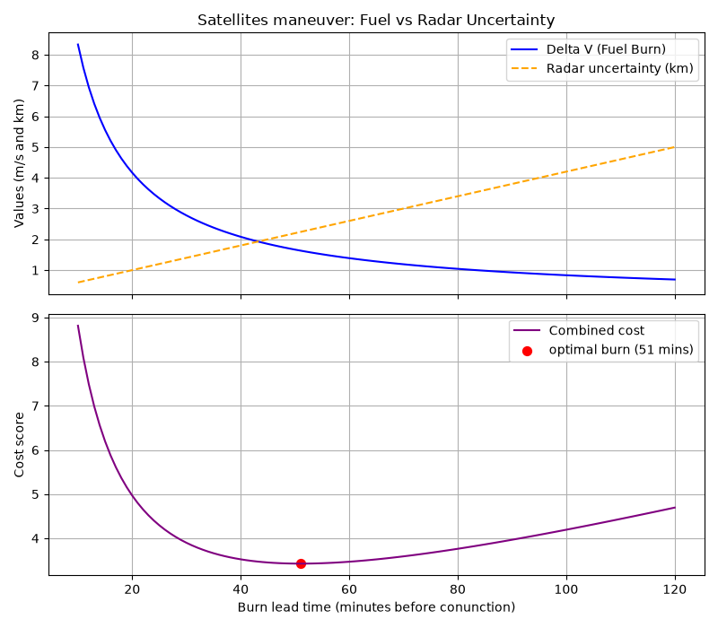

## 

# Orbital-Tradeoff-Optimizer
Python simulation analyzing the trade-off between radar positional uncertainty and delta-v fuel burn for LEO satellite collision avoidance using live NORAD TLE data

## Overview & the engineering problem

Spacecraft in Low Earth Orbit travel around 18000 miles per hour. When two of these spacecraft travel close to each other (which is classified as a conjunction), the satellite operators face a tradeoff:

1. Fuel Penalty: Waiting until the moment before a conjunction requires massive amount of burn to create enough distance between the two objects. Firing earlier allows orbital drift to take place requiring substantially less fuel.
2. Radar Tracking Uncertainty: From farther away, conjunction reading can become inaccurate. This is a result of atmospheric drag, so burning fuel hours before a conjunction can become unnecessary, as the reading can be false.

This project models that dynamic and finds the "sweet spot" that guarantees a 5 kilometer clearance while still minimizing propellant and risk. 

## How it Works:

Live Orbital Readings: The code connects to CelesTrak using the "skyfield" library in order to pull real-time NORAD orbital elements for active space stations like the ISS and CSS Tiangong.

Conjunction Detection: Builds 3d coordinates (x,y,z) minute by minute across a 1440 minutes (24 hours) to find the minimum Euclidean distance between the satellites.

Burn vs. Uncertainty Optimization: Evaluates the maneuver lead times from 10 to 120 minutes prior to the closest approach. Then calculates the required Delta V to achieve a 5 kilometer distance against a linear radarexpansion model. 

Visualization: This program creates a plot that plots the decaying fuel curve against the rising radar error line, then identifies the minimum cost window.

## Important Findings from this simulation:

Late Maneuver (10 min prior) - Requires a delta v of approximately 8.33 to achieve the 5 kilometer clearance, but benefits from high radar accuracy (0.6).
Early Maneuver (120 min prior) - Requires a delta v of only 0.69, but radar uncertainty expands to 5.0. 
Optimal Window - Across ther test parameters, the objective cost function reahed the minimum at 51 minutes prior to the conjunction (cost score: 3.426)

Requirements & Setup
pip install skyfield matplotlib numpy
